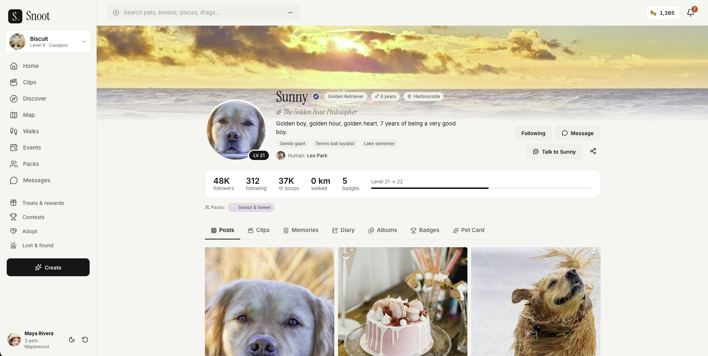

# Snoot 🐾

**The social network where every pet is the main character.**

Snoot is a full front-end for a pet-first social platform. It combines a photo feed, stories, short clips, an illustrated neighbourhood map, walk tracking, local events, communities, AI writing tools, digital scrapbooks, rewards, adoption and a lost-and-found network in one app. It's built with **React 19, TypeScript and Vite**, runs entirely in the browser on realistic sample data, and keeps a clean API layer so you can add a real backend, auth and AI later.

> Every pet, person, place, event and caption in the demo is invented. The photos are free-to-use sample images (see *Media credits*).

## Screenshot



## Run it

```bash
npm install
npm run dev        # http://localhost:5173
npm run build      # static build in dist/ (relative paths, host anywhere)
npm run preview
```

## Brand

| | |
|---|---|
| **Name** | Snoot — the bit of a pet you boop |
| **Mark** | A serif "S." on an ink tile; the terracotta full stop is the nose |
| **Colour** | Calm and editorial: near-black ink (`#161616`) on warm stone (`#F6F5F2`), one terracotta accent (`#BF5634`) kept for boops, unread and live states, plus muted evergreen, slate, ochre, plum and rose for categories. No gradients: the pet photos supply the colour. Full dark mode |
| **Type** | Instrument Serif (headlines, wordmark) + Inter (interface), both bundled via Fontsource so they work offline |
| **Voice** | Grown-up and understated in the interface; the humour lives in the pets' own posts and AI captions |
| **Signature interactions** | **Boop** (our "like", with a nose burst on double-tap), **Treats** (in-app currency, and you can give one to a post), Pet Cards, AI captions in your pet's voice |

## Features

**Social**
- **Multi-pet accounts.** One owner can run several pet profiles. A pet switcher sets who you post, comment and message as.
- **Feed** with For you / Following / Nearby tabs. Supports carousels, clips, walk posts (with route and stats overlay), milestone posts, collaborator tags, captions with hashtags and mentions, comments, boops, treats, saves and sharing to DMs. Feed modules for PawMatch, contests and events are mixed in.
- **Stories.** Rings, a full-screen viewer with progress bars, tap and hold to pause, keyboard controls, stickers, replies and boops. You can add stories from the composer.
- **Clips.** A vertical, snap-scrolling short-video feed with a side action rail, sound line, tap to pause and double-tap to boop.
- **Pet profiles.** Cover, level, AI personality archetype, traits, stats and packs. Tabs: Posts, Clips, **Memories**, **Diary**, **Albums**, **Badges**, **Pet Card**.

**AI (Snoot AI)**
- Captions in your pet's voice, with five tones, three options and streamed output. Also hashtag suggestions, "Polish" and post ideas.
- **AI personality generator** in the add-pet wizard. It builds an archetype, summary and quirks from the personality dials.
- **Breed identification** from a photo in the add-pet flow (simulated).
- **Talk to your pet.** A playful chat persona built from the pet's profile.
- **AI diary entries** written in the pet's voice, plus AI birthday posts.

**Out and about**
- **Illustrated map** of the fictional Maplewood neighbourhood, with pan and zoom. Shows parks, trails, beaches, vets, stores, groomers, cafés and trainers, plus event and lost-pet pins. Filters, search and "open now". Place pages have check-ins, saves, reviews, directions and partner coupons.
- **Walks.** A live tracker with a simulated GPS track, distance, pace, steps, mood and a demo fast-forward. Also a weekly goal ring, 7-day chart, history with route sketches, a walk detail map and a neighbourhood leaderboard. You can share a walk as a post.
- **Events.** Category and time filters, a featured event, detail pages, Going / Interested RSVPs with attendee avatars, invites, and "Host an event".
- **Packs.** Breed and interest communities with join/leave, pack feed, rules, members and pack events.

**Delight and engagement**
- **Treats & rewards.** Daily check-in streaks, a Spin & Win wheel, challenges with progress, a ledger, levels and XP, and **redeemable coupons from partner businesses**.
- **Contests.** Weekly photo contests with live vote bars, one movable vote, entry from your posts or a new upload, and a hall of fame.
- **PawMatch.** Playdate compatibility scores with reasons and one-tap playdate requests.
- **Badges, birthdays and gotcha days.** Countdowns, a celebrate mode with confetti, "On this day" memories, and collaborative albums.

**Community care**
- **Adopt.** Listings from local shelters with filters, favourites and meet-and-greet requests.
- **Lost & found.** Neighbourhood alerts on the map, "I've seen them" sightings, reporting, and a reunited wall.
- **Messages.** Inbox and threads, shared posts and events, emoji, and simulated typing and replies.

**Everywhere:** responsive layouts (floating sidebar on desktop, icon rail on tablet, bottom tab bar and menu on phones), light and dark themes, toasts, confetti and micro-interactions, keyboard support and reduced-motion support.

## Architecture

```
src/
  types/              Domain model (Owner, Pet, Post, Walk, Place, PetEvent, Pack, Contest, LostAlert, …)
  data/               seed.ts (sample world), meta.tsx (category colours/icons), mediaManifest.ts
  services/
    api.ts            ApiClient interface — the only data surface the UI uses
    mutations.ts      Every write as a serialisable command + pure applyMutation()
    mockApi.ts        In-browser backend: localStorage, latency, push events (typing, replies)
    httpApi.ts        Reference REST + WebSocket client mapping each mutation to an endpoint
    ai.ts             AiProvider interface + offline template provider + streaming helper
    storage.ts        Safe localStorage wrapper
  store/
    AppStore.tsx      Context: data, typed actions (optimistic + rewards rules), UI state
    selectors.ts      Feed ranking, PawMatch, walk stats, leaderboard, search, birthdays
  components/         ui (brand, kit), layout (nav, notifications), feed, post, stories, create,
                      map (NeighbourhoodMap, MiniRoute), profile (PetCard, AddPetWizard, PetChat)
  pages/              Home, Clips, Discover, Map, Walks, Events, Packs, Messages, Rewards,
                      Contests, Adopt, Lost & found, Pet profile, Me
  styles/             base (design tokens), layout, social, features — plain CSS, no framework
  utils/              format (time, numbers, levels), geo (routes, distances)
tools/                Image processing scripts used to build public/media
```

### Adding a backend

1. Implement the endpoints listed in `src/services/httpApi.ts`, plus `GET /me/bootstrap`, which returns the `Database` shape from `src/types`.
2. In `src/services/api.ts`, swap `createMockApi()` for `createHttpApi(import.meta.env.VITE_API_URL, getToken)`.
3. Move the reward rules that run client-side in `AppStore.tsx` to the server: Treat amounts, XP, badges and challenge progress. The mutations marked `NOOP` in `httpApi.ts` are the ones to compute server-side.

The UI applies every mutation optimistically through the same `applyMutation` reducer the mock server uses. If a write fails, the UI re-syncs from `bootstrap()`. Server pushes (new messages, typing, notifications) arrive through `api.subscribe()`.

### Adding real AI

`src/services/ai.ts` defines `AiProvider` with these methods: `captions`, `hashtags`, `improve`, `ideas`, `personality`, `diary`, `chat` and `identify`. Write a provider that calls your LLM and vision endpoints, ideally through your own backend so API keys stay off the client, and export it as `ai`. Inputs already include the pet's personality profile, so prompts can keep each pet's voice consistent.

### Real maps and GPS

`NeighbourhoodMap` uses its own illustrated base map with a 1000×700 coordinate space, so it works offline. To switch to Leaflet, Mapbox or Google, replace that one component and convert coordinates to lat/lng in an adapter. Markers, routes and callbacks keep the same shape. The walk tracker simulates movement along `generateLoop()`. Replace that with `navigator.geolocation.watchPosition` on devices.

### Uploads

Uploaded photos are downscaled to JPEG data URLs so they fit in local storage. With a backend, upload the file to object storage and store the returned URL in `MediaItem.src`.

## Media credits

Sample photos come from the [yavuzceliker/sample-images](https://github.com/yavuzceliker/sample-images) collection. It contains modified Pixabay images, which can be used under the Pixabay Content License. `tools/posts.py` and `tools/avatars.py` cropped and resized them into `public/media/`.